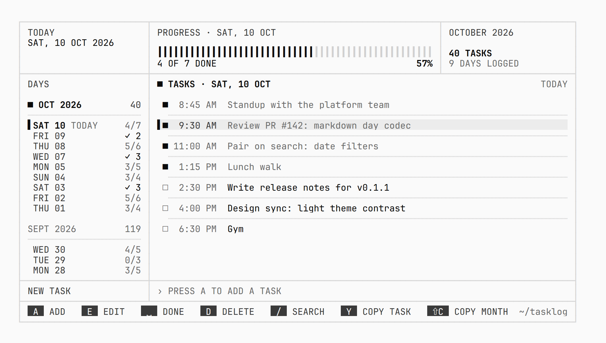

<p align="center">
  <picture>
    <source media="(prefers-color-scheme: dark)" srcset="https://shieldcn.dev/header/grid.svg?title=tasklog&subtitle=Type+it.+Tick+it.+Find+it+later.&align=left&mode=dark" />
    
  </picture>
</p>

<p align="center">
  <a href="https://www.npmjs.com/package/@piyus/tasklog"></a>
  <a href="./LICENSE"></a>
  <a href="https://bun.sh"></a>
  <a href="https://github.com/anomalyco/opentui"></a>
</p>

<p align="center">
  A keyboard-first daily task log for the terminal.<br />
  Every task is a line of plain markdown in a folder you own — no account, no database, no lock-in.
</p>

<p align="center">
  <picture>
    <source media="(prefers-color-scheme: dark)" srcset="./assets/screenshot-dark.png" />
    
  </picture>
</p>

## Features

- **Fast capture** — opens straight into the input. Type, press Enter, done. Start with `9:30 pm` to backdate.
- **Plain markdown storage** — one file per day, a generated `index.md` per month, readable anywhere.
- **Search everything** — words plus `2026`, `2026-10` or `2026-10-10` to narrow by date.
- **Safe deletes** — a red bar gives you 1.2s to cancel, then tasks go to a trash you can restore from.
- **Copy as markdown** — one task, a day, a month or a whole year, straight to your clipboard.
- **Light & dark themes** — monochrome instrument-panel design, toggled with `m` and remembered.
- **Folder history** — move your data anywhere; every folder you've used is kept so nothing gets lost.

## Install

Requires [Bun](https://bun.sh) ≥ 1.3.14.

```bash
bunx @piyus/tasklog          # try it once
npm i -g @piyus/tasklog      # or install globally
tasklog                      # then run it
```

## Keys

| Key                   | Action                                                                   |
| --------------------- | ------------------------------------------------------------------------ |
| `a`                   | add a task (start with `9:30 pm` or `21:30` to set the time)             |
| `e` / `enter`         | edit                                                                     |
| `space`               | toggle done                                                              |
| `d`                   | delete — `esc` cancels while the red bar runs, `d` again deletes now     |
| `u`                   | undo the last delete                                                     |
| `j` `k` / `↑` `↓`     | move                                                                     |
| `tab` · `[` `]` · `t` | switch pane · previous / next day · today                                |
| `/`                   | search                                                                   |
| `y`                   | copy the selected task as markdown                                       |
| `c` · `C` · `Y`       | copy day · month · year as markdown                                      |
| `T`                   | trash — `r` restores (green bar, `esc` cancels), `D` `D` deletes forever |
| `s`                   | settings — change the data folder, see every folder used before          |
| `m`                   | toggle light / dark theme                                                |
| `?` · `q`             | all keys · quit                                                          |

## Storage

```
~/tasklog/
  2026-10/
    2026-10-10.md     # one file per day:  - [x] 9:14 AM Fix login bug <!-- id:… -->
    index.md          # the whole month, generated and clean — ready to share
  .trash.md           # deleted tasks until you restore or purge them
```

Edit the day files by hand if you like: tasklog re-reads them before every write and keeps any notes that aren't tasks. Times are written 12-hour; older `21:30`-style lines still read fine.

## CLI

```bash
tasklog add "9:30 am call with design"   # log a task without opening the app
tasklog export 2026-10 > october.md      # day, month or year as markdown
tasklog where                            # data folder, config file, previous folders
tasklog --dir ~/work-log                 # use another folder for this run
```

## Configuration

| What               | Where                                                                   |
| ------------------ | ----------------------------------------------------------------------- |
| Config file        | `$XDG_CONFIG_HOME/tasklog/config.json` (`%APPDATA%\tasklog` on Windows) |
| Override location  | `TASKLOG_CONFIG_DIR=/path`                                              |
| Turn off animation | `TASKLOG_REDUCED_MOTION=1` (or `NO_MOTION=1`)                           |

## Development

```bash
bun install
bun start              # run from source
bun test               # tests
bun run typecheck
bun run format         # prettier, whole project
```

The code follows Clean Architecture: `domain` (types, ports) → `application` (use cases) → `infrastructure` (markdown files, config, clipboard), with `ui` (OpenTUI + React views) and `cli` (composition root) on the outside.

## License

[MIT](./LICENSE) © Piyush Kumar
